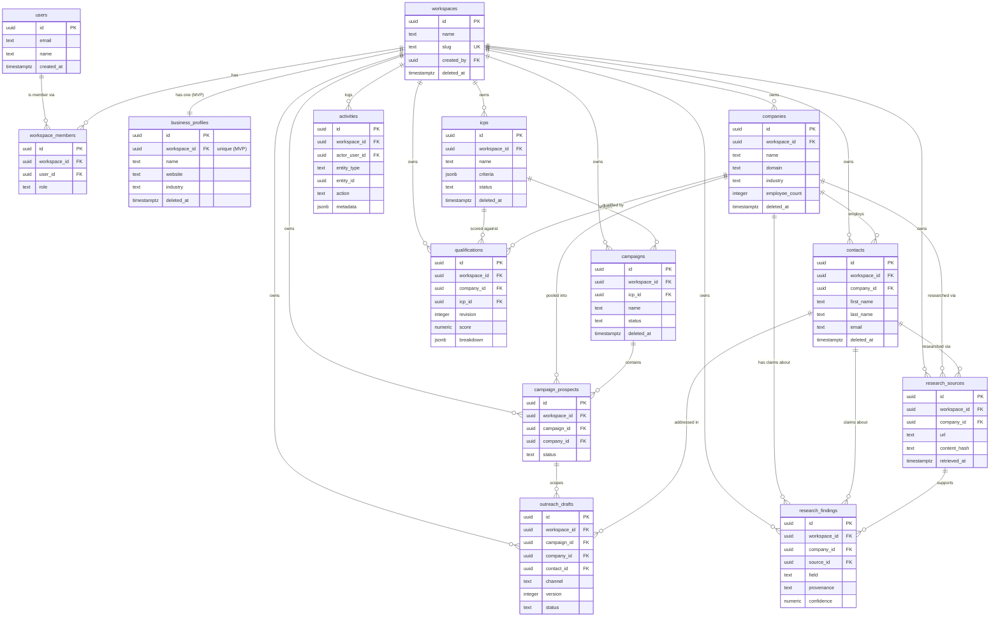

# MindLinx — Database Architecture Proposal (MVP, revised)

**Status:** Audited proposal — no schema created, no migrations written, no SQL executed.
**Revision:** 3 — applies the approved decisions (one current workspace-wide score per company + ICP with full history, shared member visibility with server-enforced roles) and the final integrity audit corrections.
**Target:** PostgreSQL 16 (local Docker on `localhost:5433`; later AWS RDS for PostgreSQL 16).
**Scope:** Multi-tenant workspace model for the Autonomous Customer Acquisition MVP.

---

## 0. Decisions reflected in this revision

| # | Decision | Effect on schema |
|---|---|---|
| 1 | **Workspace-wide prospect pool.** Companies and contacts belong to the workspace; a company can join many campaigns. | `companies`/`contacts` stay workspace-owned. `campaign_prospects` is a **membership** row, not the owner of the prospect. |
| 2 | **One business profile per workspace** for MVP. | `UNIQUE (workspace_id) WHERE deleted_at IS NULL` on `business_profiles`; the redundant FK from `icps` is removed. |
| 3 | **Draft-only outreach.** Generate, edit, regenerate, version, export. No sending, inbox, replies, follow-ups. | Draft statuses become `draft`/`approved`/`exported`/`discarded`; `sent` is gone. `contact_id` is now required. |
| 4 | **Shared workspace access.** Owner/Admin/Member all see the same prospects and research. | Documented permission matrix; no per-user row filtering; no owner column on business records. |
| 5 | **History survives removal.** Archiving a prospect from a campaign or soft-deleting a company never erases research or qualification history. | Campaign removal is a **status change**; research/qualifications have no campaign FK and are immutable. |

**Revision 3 audit corrections:** campaigns now reference ICPs through a composite key; drafts must belong to a campaign membership and to a contact of the same company; research rows use the same company-consistent contact FK; `qualifications` gained a `revision` column so "current" is deterministic; owner transfer and owner-removal rules are defined (§3.3).

**Definition used throughout:** a **prospect** is a `company` in the workspace pool. Being "in a campaign" is a `campaign_prospects` membership, not a property of the company.

---

## 1. Design principles

1. **Tenant first.** Every business record carries `workspace_id`. Nothing business-related is global.
2. **Database enforces isolation too.** Composite foreign keys make it impossible for a child row to point at a parent in another workspace — not just an application convention.
3. **The pool is workspace-level; campaigns are lenses.** Campaign membership and campaign status never own the prospect's data.
4. **Append-only where history matters.** Research, qualifications, drafts and activity are never updated in place; new rows record change.
5. **Soft delete only where users expect undo.** Companies, contacts, campaigns, ICPs and the profile get `deleted_at`. Evidence and audit rows are immutable.
6. **No speculative tables.** Billing, notifications, email delivery events, vector search, file storage and a global company registry are deliberately excluded (see §11).
7. **Portable types only.** `uuid`, `text`, `jsonb`, `numeric`, `timestamptz`, `date`, `integer`. No custom extensions, no `citext`, no enums (see §12).

---

## 2. Entity relationship diagram



> ERD scope note: `outreach_drafts` is drawn under `campaign_prospects` and `contacts` because those are its enforcing FKs. It still carries `campaign_id` and `company_id` columns (shown in the entity block), but has no direct FK to `campaigns` or `companies` — see §3.13.

---

## 3. Proposed tables

Conventions used everywhere:

- `id uuid PRIMARY KEY DEFAULT gen_random_uuid()` (built into PostgreSQL 13+, no extension).
- `created_at timestamptz NOT NULL DEFAULT now()`, `updated_at timestamptz NOT NULL DEFAULT now()`.
- `deleted_at timestamptz NULL` only on soft-deleted entities.
- Status/role columns are `text` + `CHECK` constraints (see §12).
- All timestamps are `timestamptz` (never `timestamp`).

### 3.1 `users`

Owned by **Better Auth**; MindLinx treats it as read-only reference data.

| Column | Type | Constraints |
|---|---|---|
| `id` | uuid | PK |
| `email` | text | NOT NULL, UNIQUE, UNIQUE `(lower(email))` |
| `email_verified` | boolean | NOT NULL, default false |
| `name` | text | NOT NULL |
| `image` | text | NULL |
| `created_at` | timestamptz | NOT NULL, default now() |
| `updated_at` | timestamptz | NOT NULL, default now() |

### 3.1.1 Better Auth tables

Owned by Better Auth and never written by application code. They hold session,
credential and reset-token state; workspace membership stays in
`workspace_members`.

| Table | Purpose | Key constraints |
|---|---|---|
| `session` | one row per active login | `token` UNIQUE, `user_id` → `users(id)` ON DELETE CASCADE |
| `account` | credentials and OAuth links; `password` holds the scrypt hash | UNIQUE `(provider_id, account_id)`, `user_id` → `users(id)` ON DELETE CASCADE |
| `verification` | password-reset and other short-lived tokens | `identifier` indexed |

All four `id` columns are uuids, so Better Auth must run with
`advanced.database.generateId = "uuid"`.

### 3.2 `workspaces`

The tenant root.

| Column | Type | Constraints |
|---|---|---|
| `id` | uuid | PK |
| `name` | text | NOT NULL |
| `slug` | text | NOT NULL, UNIQUE (global, used in URLs) |
| `created_by` | uuid | NULL → `users(id)` ON DELETE SET NULL |
| `created_at` / `updated_at` | timestamptz | NOT NULL |
| `deleted_at` | timestamptz | NULL |

### 3.3 `workspace_members`

| Column | Type | Constraints |
|---|---|---|
| `id` | uuid | PK |
| `workspace_id` | uuid | NOT NULL → `workspaces(id)` ON DELETE CASCADE |
| `user_id` | uuid | NOT NULL → `users(id)` ON DELETE CASCADE |
| `role` | text | NOT NULL, CHECK IN (`owner`,`admin`,`member`) |
| `created_at` / `updated_at` | timestamptz | NOT NULL |

- `UNIQUE (workspace_id, user_id)` — one membership per user per workspace.
- `UNIQUE (workspace_id) WHERE role = 'owner'` — exactly one owner, enforced by the database.
- Cascade is correct here: membership is not business history.

**Ownership and membership rules (server-enforced, transactional):**

- Exactly one `owner` per workspace: the partial unique index guarantees **≤ 1**; the server enforces **≥ 1**.
- An owner **cannot be removed**, and cannot be demoted except as the first step of a transfer. There is no path that leaves the workspace ownerless outside the transfer transaction.
- **Transfer ownership** runs in one transaction under a workspace row lock (`SELECT ... FOR UPDATE`): demote the current owner to `admin`, then promote the target member to `owner`. The ownerless state exists only inside the transaction, and the partial index is checked per statement, so this order is safe. The lock prevents two concurrent transfers from interleaving.
- Admins may invite, remove and re-role `member` and `admin` rows. Admins cannot touch the owner row and cannot grant `owner`.
- The last remaining owner cannot leave the workspace; the server rejects it.
- A user who owns a workspace **cannot be deleted** until ownership is transferred. `workspace_members.user_id` cascades from `users`, so an unguarded account deletion would remove the owner row and leave the tenant ownerless.
- A member may leave voluntarily unless they are the owner.
- Permission checks live in server actions/route handlers. Hiding a button in the UI is not authorization.

**Permission matrix (application-enforced, shared data visibility):**

| Capability | Owner | Admin | Member |
|---|---|---|---|
| View all workspace prospects, research, drafts | ✅ | ✅ | ✅ |
| Create/edit companies, contacts, ICPs, campaigns | ✅ | ✅ | ✅ |
| Generate/edit/export drafts | ✅ | ✅ | ✅ |
| Delete (soft) companies, contacts, campaigns | ✅ | ✅ | ❌ |
| Invite/remove members, change roles | ✅ | ✅ (not owner) | ❌ |
| Transfer ownership | ✅ | ❌ | ❌ |
| Rename/delete workspace | ✅ | ❌ | ❌ |

There is **no per-user row ownership** on business data. Authorization is "are you a member of this workspace"; everything inside is shared.

### 3.4 `business_profiles`

Who the customer *is* (the seller's own company), used to shape ICPs and outreach voice. **One per workspace in MVP.**

| Column | Type | Constraints |
|---|---|---|
| `id` | uuid | PK |
| `workspace_id` | uuid | NOT NULL → `workspaces(id)` ON DELETE CASCADE |
| `name` | text | NOT NULL |
| `website` | text | NULL |
| `industry` | text | NULL |
| `description` | text | NULL |
| `created_at` / `updated_at` | timestamptz | NOT NULL |
| `deleted_at` | timestamptz | NULL |

- `UNIQUE (workspace_id) WHERE deleted_at IS NULL` — exactly one live profile per workspace.
- The partial predicate lets a soft-deleted profile be replaced without a data purge.
- **Future phase (multi-profile):** drop this unique index and add a nullable `business_profile_id` to `icps` (and later to `campaigns` if campaigns become brand-specific). No data rewrite needed.

### 3.5 `icps`

| Column | Type | Constraints |
|---|---|---|
| `id` | uuid | PK |
| `workspace_id` | uuid | NOT NULL → `workspaces(id)` ON DELETE CASCADE |
| `name` | text | NOT NULL |
| `description` | text | NULL |
| `criteria` | jsonb | NOT NULL, default `'{}'` |
| `status` | text | NOT NULL, CHECK IN (`active`,`archived`) |
| `created_at` / `updated_at` | timestamptz | NOT NULL |
| `deleted_at` | timestamptz | NULL |

**No `business_profile_id`.** With one profile per workspace, the workspace already determines it; the column would always hold the same value. Adding it back is a one-column migration when multi-profile lands.

- `UNIQUE (workspace_id, id)` — required as the composite-FK target for `campaigns` and `qualifications`.

`criteria` shape (application-validated with Zod, not by the database):

```json
{
  "industries": ["saas", "fintech"],
  "employeeRange": { "min": 20, "max": 500 },
  "countries": ["US", "GB"],
  "titles": ["Head of Marketing", "VP Sales"],
  "keywords": ["outbound", "revops"]
}
```

> Trade-off: `jsonb` keeps the MVP schema small and lets criteria evolve without migrations. It is **not** indexable by structure until we add GIN or normalise the criteria — see §10.

### 3.6 `campaigns`

| Column | Type | Constraints |
|---|---|---|
| `id` | uuid | PK |
| `workspace_id` | uuid | NOT NULL → `workspaces(id)` ON DELETE CASCADE |
| `icp_id` | uuid | NULL → **composite** FK `(workspace_id, icp_id)` → `icps(workspace_id, id)` ON DELETE SET NULL (`icp_id` only) |
| `name` | text | NOT NULL |
| `status` | text | NOT NULL, CHECK IN (`draft`,`active`,`paused`,`archived`) |
| `start_date` | date | NULL |
| `created_by` | uuid | NULL → `users(id)` ON DELETE SET NULL |
| `created_at` / `updated_at` | timestamptz | NOT NULL |
| `deleted_at` | timestamptz | NULL |

- `UNIQUE (workspace_id, id)` — required as the composite-FK target for `campaign_prospects`.
- `icp_id` is nullable so a campaign can be assembled by hand before an ICP exists. Because the FK is composite, a campaign can only point at an ICP **in its own workspace**.
- `ON DELETE SET NULL (icp_id)` is PostgreSQL 15+ syntax: it nulls only `icp_id`, never `workspace_id` (which is `NOT NULL`). Without the column list, a hard ICP delete would try to null the tenant column and fail.
- Hard-deleting an ICP with qualification history is already blocked by `qualifications` RESTRICT; the normal path is to soft-delete or set `icps.status = 'archived'`.

### 3.7 `companies`

A prospect **organization** in the workspace pool. Never a person, never campaign-owned.

| Column | Type | Constraints |
|---|---|---|
| `id` | uuid | PK |
| `workspace_id` | uuid | NOT NULL → `workspaces(id)` ON DELETE CASCADE |
| `name` | text | NOT NULL |
| `domain` | text | NULL (stored lowercase, no scheme) |
| `website` | text | NULL |
| `industry` | text | NULL |
| `employee_count` | integer | NULL, CHECK >= 0 |
| `country` | text | NULL (ISO-3166 alpha-2) |
| `description` | text | NULL |
| `source` | text | NOT NULL, CHECK IN (`manual`,`discovery`,`import`) |
| `created_at` / `updated_at` | timestamptz | NOT NULL |
| `deleted_at` | timestamptz | NULL |

- `UNIQUE (workspace_id, lower(domain)) WHERE domain IS NOT NULL AND deleted_at IS NULL`
- `UNIQUE (workspace_id, id)` — required for composite tenant FKs (see §5).
- **Companies are per-workspace, not global.** Two tenants tracking the same company get two rows. Intentional: isolation stays trivial and each tenant holds its own research. The cost is duplication (§10).
- A company's research, qualifications and drafts live on the company, **not** on a campaign. Removing it from one campaign cannot touch them.

### 3.8 `contacts`

A prospect **person**, always attached to a company in the same workspace.

| Column | Type | Constraints |
|---|---|---|
| `id` | uuid | PK |
| `workspace_id` | uuid | NOT NULL → `workspaces(id)` ON DELETE CASCADE |
| `company_id` | uuid | NOT NULL |
| `first_name` | text | NULL |
| `last_name` | text | NULL |
| `title` | text | NULL |
| `email` | text | NULL (stored lowercase) |
| `linkedin_url` | text | NULL |
| `created_at` / `updated_at` | timestamptz | NOT NULL |
| `deleted_at` | timestamptz | NULL |

- Composite FK: `(workspace_id, company_id) → companies(workspace_id, id)` ON DELETE RESTRICT.
- `UNIQUE (workspace_id, id)` — required for composite tenant FKs.
- `UNIQUE (workspace_id, company_id, id)` — required so a draft/research row can prove its contact belongs to the same company.
- `UNIQUE (workspace_id, company_id, lower(email)) WHERE email IS NOT NULL AND deleted_at IS NULL` — prevents duplicates within a company while still allowing the same person to be tracked at two companies (the person/employment split is a later concern — see §13, People vs employment).

### 3.9 `campaign_prospects` (membership, not ownership)

Which company from the workspace pool is being worked in which campaign.

| Column | Type | Constraints |
|---|---|---|
| `id` | uuid | PK |
| `workspace_id` | uuid | NOT NULL → `workspaces(id)` ON DELETE CASCADE |
| `campaign_id` | uuid | NOT NULL |
| `company_id` | uuid | NOT NULL |
| `status` | text | NOT NULL, CHECK IN (`new`,`researching`,`qualified`,`drafted`,`archived`,`disqualified`) |
| `created_at` / `updated_at` | timestamptz | NOT NULL |

- `UNIQUE (workspace_id, campaign_id, company_id)` — one membership per company/campaign, and the composite-FK target that lets a draft prove its campaign/company pair is real and in the same workspace.
- `UNIQUE (campaign_id, company_id)` is implied by the above; do not add both.
- Composite FKs: `(workspace_id, campaign_id) → campaigns(workspace_id, id)` and `(workspace_id, company_id) → companies(workspace_id, id)`, both ON DELETE RESTRICT.
- **Removal is `status = 'archived'`, never a delete.** The row stays, so "this company was in this campaign" survives.
- A company can only be added to a campaign in the **same workspace**: both composite FKs carry `workspace_id`, so a cross-tenant membership row is impossible.
- Re-adding an archived company **reactivates the same row** (status back to `new`); the add/remove events are recorded in `activities`.
- Status is campaign-scoped by design: the same company can be `qualified` in one campaign and `new` in another.
- No contact rows here. Contacts are workspace-level; a prospect is a company, and individual targeting lives in `outreach_drafts`.
- `contacted`/`replied`/`won`/`lost` are **removed** — there is no sending in MVP.

### 3.10 `research_sources`

Evidence: where a claim came from. Immutable, workspace-level.

| Column | Type | Constraints |
|---|---|---|
| `id` | uuid | PK |
| `workspace_id` | uuid | NOT NULL → `workspaces(id)` ON DELETE CASCADE |
| `company_id` | uuid | NOT NULL → composite FK `(workspace_id, company_id)` → `companies(workspace_id, id)` |
| `contact_id` | uuid | NULL → composite FK `(workspace_id, company_id, contact_id)` → `contacts(workspace_id, company_id, id)` |
| `url` | text | NOT NULL |
| `title` | text | NULL |
| `publisher` | text | NULL |
| `source_type` | text | NOT NULL, CHECK IN (`website`,`linkedin`,`news`,`filing`,`manual`) |
| `retrieved_at` | timestamptz | NOT NULL |
| `content_hash` | text | NULL (sha256 of fetched content) |
| `excerpt` | text | NULL (short quoted passage, not a full page copy) |
| `created_at` | timestamptz | NOT NULL |

- `UNIQUE (workspace_id, id)` — required as the composite-FK target for `research_findings.source_id`.
- Both FKs are composite and RESTRICT. A source cannot cite a contact from a different company or a different workspace.
- `contact_id` is nullable; the FK uses the default `MATCH SIMPLE`, so the constraint is skipped when `contact_id IS NULL`. That is the intended meaning: no contact, no check.

No `updated_at` and no `deleted_at`: a source is a historical fact of retrieval. A re-crawl creates a new row; `content_hash` lets the app skip identical snapshots.

### 3.11 `research_findings`

A claim about a company or contact, with provenance. Workspace-level.

| Column | Type | Constraints |
|---|---|---|
| `id` | uuid | PK |
| `workspace_id` | uuid | NOT NULL → `workspaces(id)` ON DELETE CASCADE |
| `company_id` | uuid | NOT NULL → composite FK `(workspace_id, company_id)` → `companies(workspace_id, id)` |
| `contact_id` | uuid | NULL → composite FK `(workspace_id, company_id, contact_id)` → `contacts(workspace_id, company_id, id)` |
| `source_id` | uuid | NULL → composite FK `(workspace_id, source_id)` → `research_sources(workspace_id, id)` ON DELETE SET NULL (`source_id` only) |
| `field` | text | NOT NULL (e.g. `employee_count`, `tech_stack`, `hiring_signal`) |
| `statement` | text | NOT NULL (human-readable claim) |
| `value` | jsonb | NULL (structured value when applicable) |
| `provenance` | text | NOT NULL, CHECK IN (`verified`,`inferred`) |
| `confidence` | numeric(3,2) | NULL, CHECK 0 ≤ x ≤ 1 |
| `model` | text | NULL (model id for inferences) |
| `created_at` | timestamptz | NOT NULL |

Constraints that encode the requirement:

- `CHECK (provenance <> 'verified' OR source_id IS NOT NULL)` — **a verified fact must cite evidence.**
- `CHECK (provenance <> 'inferred' OR model IS NOT NULL)` — **an AI inference must record what produced it.**
- The `contact_id` and `source_id` FKs use `MATCH SIMPLE`: when either is `NULL` the constraint is skipped, which is the intended "not about a person / no cited source" case. When present, both are workspace-consistent by construction.
- Append-only. A corrected fact is a new row; the app reads the latest per `(company_id, field)`.

### 3.12 `qualifications`

Explainable scoring. **Workspace-wide**, keyed by company + ICP. Append-only history.

| Column | Type | Constraints |
|---|---|---|
| `id` | uuid | PK |
| `workspace_id` | uuid | NOT NULL → `workspaces(id)` ON DELETE CASCADE |
| `company_id` | uuid | NOT NULL → composite FK `(workspace_id, company_id)` → `companies(workspace_id, id)` |
| `icp_id` | uuid | NOT NULL → composite FK `(workspace_id, icp_id)` → `icps(workspace_id, id)` |
| `revision` | integer | NOT NULL, CHECK >= 1 |
| `score` | numeric(5,2) | NOT NULL, CHECK 0 ≤ x ≤ 100 |
| `band` | text | NULL, CHECK IN (`hot`,`warm`,`cold`,`disqualified`) |
| `summary` | text | NOT NULL (plain-language explanation) |
| `breakdown` | jsonb | NOT NULL, default `'[]'` |
| `model` | text | NULL |
| `prompt_version` | text | NULL |
| `created_at` | timestamptz | NOT NULL |

**Decision — why no `campaign_id`:** an ICP is workspace-level, and a company's fit against that ICP does not change because it was added to a second campaign. Scoring per campaign would duplicate identical rows and invite drift. `campaign_id` was removed in this revision.

**Append-only and deterministic "current":**

- `UNIQUE (workspace_id, company_id, icp_id, revision)` — two rows can never claim the same revision for the same company + ICP.
- `revision` is assigned by the server as `max(revision) + 1` for that `(company_id, icp_id)` **inside the same transaction** as the insert. Two concurrent runs can compute the same number; the loser gets a unique violation and retries. No sequence, no gaps requirement.
- **Current score = the row with the highest `revision`** for a `(company_id, icp_id)`. This is deterministic and does not depend on clock resolution or `created_at` ties.
- `revision` is never reused, even if a row were removed; rows are not removed in normal operation.
- The table is append-only: the application has no update/delete path. A correction or re-score is a new row with `revision + 1`.
- Campaigns inherit the score through their `icp_id`; the same company therefore has one current score per ICP regardless of how many campaigns reference it.
- If campaign-specific overrides are ever needed (e.g. an A/B scoring model per campaign), add a **nullable** `campaign_id` plus a partial unique index — additive migration, no rewrite.
- "Which campaign triggered this run" is captured in `activities.metadata`, not in a column.

`breakdown` shape:

```json
[
  { "criterion": "industry", "weight": 0.3, "score": 90, "reason": "B2B SaaS, matches ICP" },
  { "criterion": "size", "weight": 0.2, "score": 40, "reason": "1,200 employees, above target band" }
]
```

### 3.13 `outreach_drafts`

Versioned, draft-only output. Append-only.

| Column | Type | Constraints |
|---|---|---|
| `id` | uuid | PK |
| `workspace_id` | uuid | NOT NULL → `workspaces(id)` ON DELETE CASCADE |
| `campaign_id` | uuid | NOT NULL → composite FK `(workspace_id, campaign_id, company_id)` → `campaign_prospects(workspace_id, campaign_id, company_id)` |
| `company_id` | uuid | NOT NULL → **same** membership FK above (company is part of the key) |
| `contact_id` | uuid | **NOT NULL** → composite FK `(workspace_id, company_id, contact_id)` → `contacts(workspace_id, company_id, id)` |
| `channel` | text | NOT NULL, CHECK IN (`email`,`linkedin`) |
| `subject` | text | NULL |
| `body` | text | NOT NULL |
| `status` | text | NOT NULL, CHECK IN (`draft`,`approved`,`exported`,`discarded`) |
| `version` | integer | NOT NULL, default 1, CHECK >= 1 |
| `model` | text | NULL |
| `prompt_version` | text | NULL |
| `created_by` | uuid | NULL → `users(id)` ON DELETE SET NULL |
| `created_at` / `updated_at` | timestamptz | NOT NULL |

- **Consistency is enforced by two composite FKs, not by app checks:**
  1. `(workspace_id, campaign_id, company_id) → campaign_prospects(workspace_id, campaign_id, company_id)` — the company must actually be a member of that campaign, in the same workspace.
  2. `(workspace_id, company_id, contact_id) → contacts(workspace_id, company_id, id)` — the contact must belong to that same company, in the same workspace.
  Together they make an inconsistent `workspace / campaign / company / contact` tuple impossible at the database level.
- Both FKs are `ON DELETE RESTRICT`. A campaign membership is archived, never deleted, so draft history survives removal of the prospect from the campaign.
- The FK does not inspect `campaign_prospects.status`; whether an `archived` prospect can receive a **new** draft is an application rule. Existing drafts stay valid either way.
- `contact_id` is **required**: "personalized" means a named person. This also makes the version key deterministic.
- `UNIQUE (campaign_id, contact_id, channel, version)` — one row per version of one draft thread.
- `version` is assigned as `max(version) + 1` for that `(campaign_id, contact_id, channel)` in the same transaction as the insert; a concurrent writer that loses the race gets a unique violation and retries.
- Editing or regenerating creates `version + 1`; the previous row stays. "Discard" is a status, not a delete.
- `exported` records that the user took the draft out of MindLinx. Nothing is sent by the platform.
- A soft-deleted contact or company keeps its row, so existing drafts still resolve. New drafts against a soft-deleted contact should be rejected by the application.
- No `deleted_at`: draft history is the point.

### 3.14 `activities`

Append-only event log for the workspace timeline.

| Column | Type | Constraints |
|---|---|---|
| `id` | uuid | PK |
| `workspace_id` | uuid | NOT NULL → `workspaces(id)` ON DELETE CASCADE |
| `actor_user_id` | uuid | NULL → `users(id)` ON DELETE SET NULL (null = system/AI) |
| `entity_type` | text | NOT NULL, CHECK IN (`workspace`,`company`,`contact`,`campaign`,`prospect`,`icp`,`qualification`,`draft`) |
| `entity_id` | uuid | NOT NULL |
| `action` | text | NOT NULL (e.g. `created`,`updated`,`qualified`,`draft_generated`,`draft_exported`,`prospect_archived`,`status_changed`) |
| `metadata` | jsonb | NOT NULL, default `'{}'` |
| `created_at` | timestamptz | NOT NULL |

`entity_id` is intentionally **not** a foreign key: one column cannot reference eight tables. Integrity for the timeline is enforced by the writer, and the log must survive deletion of the entity it mentions.

---

## 4. Keys and cardinalities

| Parent | Child | Cardinality | On delete |
|---|---|---|---|
| `users` | `workspace_members` | 1 : N | CASCADE |
| `workspaces` | `workspace_members` | 1 : N | CASCADE |
| `workspaces` | `business_profiles` | **1 : 1 (live)** | CASCADE |
| `workspaces` | all other tenant tables (`icps`, `campaigns`, `companies`, `contacts`, `campaign_prospects`, `research_sources`, `research_findings`, `qualifications`, `outreach_drafts`, `activities`) | 1 : N | CASCADE |
| `icps` | `campaigns` | 1 : N | SET NULL (`icp_id` only) |
| `icps` | `qualifications` | 1 : N | RESTRICT |
| `companies` | `contacts` | 1 : N | RESTRICT |
| `companies` | `campaign_prospects` | **1 : N (many campaigns)** | RESTRICT |
| `campaigns` | `campaign_prospects` | 1 : N | RESTRICT |
| `campaign_prospects` | `outreach_drafts` | 1 : N | RESTRICT |
| `companies` | `research_sources`, `research_findings`, `qualifications` | 1 : N | RESTRICT |
| `contacts` | `research_sources`, `research_findings`, `outreach_drafts` | 1 : N | RESTRICT |
| `research_sources` | `research_findings` | 1 : N | SET NULL (`source_id` only) |

`RESTRICT` on business children is deliberate: a hard delete of a company with history must be an explicit, ordered operation, never an accidental cascade.

**Draft parentage is explicit, not implied:** `outreach_drafts` has **no direct FK to `campaigns` or `companies`**. Its campaign/company pair is checked against `campaign_prospects`, and its contact is checked against `contacts(workspace_id, company_id, id)`. The `campaign_id` and `company_id` columns are kept for query convenience and as part of those composite keys.

**Many-to-many in practice:** `companies ↔ campaigns` is M:N, resolved by `campaign_prospects`. A company may appear in zero campaigns (just pooled) or many.

---

## 5. Workspace isolation strategy

Three layers, cheapest first:

1. **Column-level:** `workspace_id` is `NOT NULL` on all 12 tenant tables. No nullable tenancy, ever.
2. **Composite foreign keys (the important one):**
   ```sql
   -- parents expose a workspace-scoped key
   ALTER TABLE companies ADD CONSTRAINT companies_workspace_id_key UNIQUE (workspace_id, id);
   -- children must reference the pair
   ALTER TABLE contacts
     ADD CONSTRAINT contacts_company_fk
     FOREIGN KEY (workspace_id, company_id) REFERENCES companies (workspace_id, id);
   ```
   A contact physically cannot reference a company in another workspace. This is enforced by the engine, not by a code review.

   Required parent unique keys (one per referenced key):

   | Parent | Unique key | Referenced by |
   |---|---|---|
   | `workspaces` | `(id)` | every tenant table's `workspace_id` |
   | `companies` | `(workspace_id, id)` | `contacts`, `campaign_prospects`, `research_sources`, `research_findings`, `qualifications` |
   | `contacts` | `(workspace_id, id)` | (base tenant key) |
   | `contacts` | `(workspace_id, company_id, id)` | `research_sources`, `research_findings`, `outreach_drafts` |
   | `campaigns` | `(workspace_id, id)` | `campaign_prospects` |
   | `icps` | `(workspace_id, id)` | `campaigns`, `qualifications` |
   | `campaign_prospects` | `(workspace_id, campaign_id, company_id)` | `outreach_drafts` |
   | `research_sources` | `(workspace_id, id)` | `research_findings` |

   **Complete tenant-FK matrix (every tenant-owned relationship):**

   | Child | Composite FK |
   |---|---|
   | `business_profiles` | `(workspace_id) → workspaces(id)` |
   | `icps` | `(workspace_id) → workspaces(id)` |
   | `campaigns` | `(workspace_id) → workspaces(id)`; `(workspace_id, icp_id) → icps(workspace_id, id)` |
   | `companies` | `(workspace_id) → workspaces(id)` |
   | `contacts` | `(workspace_id) → workspaces(id)`; `(workspace_id, company_id) → companies(workspace_id, id)` |
   | `campaign_prospects` | `(workspace_id) → workspaces(id)`; `(workspace_id, campaign_id) → campaigns(workspace_id, id)`; `(workspace_id, company_id) → companies(workspace_id, id)` |
   | `research_sources` | `(workspace_id) → workspaces(id)`; `(workspace_id, company_id) → companies(workspace_id, id)`; `(workspace_id, company_id, contact_id) → contacts(workspace_id, company_id, id)` |
   | `research_findings` | `(workspace_id) → workspaces(id)`; `(workspace_id, company_id) → companies(workspace_id, id)`; `(workspace_id, company_id, contact_id) → contacts(workspace_id, company_id, id)`; `(workspace_id, source_id) → research_sources(workspace_id, id)` |
   | `qualifications` | `(workspace_id) → workspaces(id)`; `(workspace_id, company_id) → companies(workspace_id, id)`; `(workspace_id, icp_id) → icps(workspace_id, id)` |
   | `outreach_drafts` | `(workspace_id) → workspaces(id)`; `(workspace_id, campaign_id, company_id) → campaign_prospects(workspace_id, campaign_id, company_id)`; `(workspace_id, company_id, contact_id) → contacts(workspace_id, company_id, id)` |
   | `activities` | `(workspace_id) → workspaces(id)`; `entity_id` is deliberately **not** an FK (see §3.14) |

   `workspace_members` is the one table that uses a plain `workspace_id → workspaces(id)` FK plus `user_id → users(id)`; there is no composite child key to protect.

   **Nullable composite FKs use the default `MATCH SIMPLE`.** A `NULL` in any referenced column skips the check. This is safe here because only the optional parents are nullable (`campaigns.icp_id`, `research_sources.contact_id`, `research_findings.contact_id`, `research_findings.source_id`); `workspace_id` and the other parent ids are `NOT NULL`, so a partial `NULL` always means "no optional parent", never "unknown tenant".

3. **Access layer:** one repository module per entity, every function takes `workspaceId` from the authenticated session and injects it into the `WHERE` clause. `process.env`/raw DB access stays out of route handlers and components.

**Shared access inside a workspace is intentional.** Owner, Admin and Member all read the same pool; the permission matrix in §3.3 governs mutations, not visibility. No `owner_user_id` columns exist on business records, so there is nothing to leak between members.

**Phase 2 (not MVP):** PostgreSQL Row-Level Security with `SET LOCAL app.workspace_id`, plus a pooled connection strategy. RLS is strong defence-in-depth but adds connection-pooling friction that is not worth paying for before there are real users.

**Never** do cross-workspace joins or "global" queries without an explicit `workspace_id` filter, and never accept a `workspace_id` from a request body — derive it from the session.

---

## 6. Indexes and uniqueness

Minimum useful set (all composite indexes lead with `workspace_id` so tenant filtering stays cheap):

| Table | Index / constraint | Purpose |
|---|---|---|
| `workspaces` | `UNIQUE (slug)` | URL routing |
| `workspace_members` | `UNIQUE (workspace_id, user_id)` | no duplicate membership |
| `workspace_members` | `UNIQUE (workspace_id) WHERE role='owner'` | exactly one owner |
| `workspace_members` | `INDEX (user_id)` | "my workspaces" |
| `business_profiles` | `UNIQUE (workspace_id) WHERE deleted_at IS NULL` | one live profile |
| `icps` | `UNIQUE (workspace_id, id)` | composite FK target (campaigns, qualifications) |
| `campaigns` | `UNIQUE (workspace_id, id)` | composite FK target (campaign_prospects) |
| `companies` | `UNIQUE (workspace_id, id)` | composite FK target |
| `companies` | `UNIQUE (workspace_id, lower(domain)) WHERE domain IS NOT NULL AND deleted_at IS NULL` | dedupe discovery results |
| `companies` | `INDEX (workspace_id, created_at DESC)` | pool list |
| `contacts` | `UNIQUE (workspace_id, id)` | composite FK target |
| `contacts` | `UNIQUE (workspace_id, company_id, id)` | contact-belongs-to-company FK target |
| `contacts` | `UNIQUE (workspace_id, company_id, lower(email)) WHERE email IS NOT NULL AND deleted_at IS NULL` | dedupe within company |
| `contacts` | `INDEX (workspace_id, company_id)`, `INDEX (workspace_id, email)` | company contacts, lookup |
| `campaign_prospects` | `UNIQUE (workspace_id, campaign_id, company_id)` | one membership per company/campaign; draft FK target |
| `campaign_prospects` | `INDEX (workspace_id, status)`, `INDEX (workspace_id, company_id)` | pipeline board, "which campaigns is this company in" |
| `campaign_prospects` | `INDEX (campaign_id, status)` | campaign board |
| `research_sources` | `UNIQUE (workspace_id, id)` | composite FK target for findings |
| `research_sources` | `INDEX (workspace_id, company_id, retrieved_at DESC)` | company research feed |
| `research_findings` | `INDEX (workspace_id, company_id, field, created_at DESC)` | latest claim per field |
| `qualifications` | `UNIQUE (workspace_id, company_id, icp_id, revision)` | append-only revision identity; also serves the current-score lookup (scan backwards on `revision`) |
| `qualifications` | `INDEX (workspace_id, icp_id, revision DESC)` | ICP leaderboard |
| `outreach_drafts` | `UNIQUE (campaign_id, contact_id, channel, version)` | versioning |
| `outreach_drafts` | `INDEX (workspace_id, campaign_id, company_id)` | membership FK / campaign queue |
| `outreach_drafts` | `INDEX (workspace_id, company_id, contact_id)` | contact FK / contact history |
| `outreach_drafts` | `INDEX (workspace_id, status)` | queues |
| `activities` | `INDEX (workspace_id, created_at DESC)`, `INDEX (entity_type, entity_id, created_at DESC)` | timeline |

Deferred until a query proves it needs them: `pg_trgm` on company name, GIN on `icps.criteria`, GIN on `qualifications.breakdown`.

---

## 7. Deletion and retention

| Entity | Strategy | Behaviour |
|---|---|---|
| `workspace_members` | hard delete | Membership ends; no history value |
| `workspaces` | soft delete → scheduled purge | `deleted_at` set; 30-day grace; then ordered hard delete |
| `business_profiles`, `icps`, `campaigns` | soft delete | Hidden from UI, preserved for history |
| `companies`, `contacts` | soft delete | Preserved so drafts/qualifications keep meaning |
| `campaign_prospects` | **status `archived`** | Row kept; never deleted. Re-add reactivates it |
| `research_sources`, `research_findings` | immutable | Never updated or deleted by users |
| `qualifications` | immutable | Superseded by newer rows |
| `outreach_drafts` | status `discarded` | Never deleted |

**Two different removals — do not conflate them:**

- `deleted_at` = the record is removed from default queries (user deleted it).
- `status = 'archived'` = the record is still live business history but no longer active.

They are independent. A campaign can be `status='archived'` and still visible in archive views, or soft-deleted and hidden everywhere.

**Soft-delete propagation:**

| Action | Row changed | Left untouched | Result |
|---|---|---|---|
| Soft-delete a workspace | `workspaces.deleted_at` | all children | Whole tenant hidden; purge job hard-deletes later in FK order |
| Soft-delete a company | `companies.deleted_at` | contacts, campaign_prospects, research_*, qualifications, drafts | Company leaves the pool; history and campaign memberships still resolve |
| Soft-delete a contact | `contacts.deleted_at` | research_*, findings, drafts | Contact hidden from pickers; existing drafts keep a valid FK |
| Soft-delete a campaign | `campaigns.deleted_at` | campaign_prospects, drafts | Campaign hidden; memberships and draft history remain |
| Soft-delete an ICP | `icps.deleted_at` | `campaigns.icp_id`, qualifications | Campaigns still point at the archived ICP; scoring history intact |
| Archive a prospect in a campaign | `campaign_prospects.status='archived'` | everything else | Company stays in the pool and in other campaigns |
| Archive an ICP or campaign | `status='archived'` | children | Still queryable in archive views; `deleted_at` unaffected |
| Discard a draft | `outreach_drafts.status='discarded'` | the row | Draft history kept |

Rules:

- **No soft delete cascades.** Only the addressed row's `deleted_at` changes; children are filtered by joining to a live parent, not by being marked.
- **Archiving a prospect from a campaign touches exactly one row** (`campaign_prospects.status`). Research, findings, qualifications and drafts have no campaign FK, so they cannot be affected.
- Soft-deleted rows are excluded by the repository layer (`WHERE deleted_at IS NULL`), never by ad-hoc filters in components.
- Partial unique indexes include `deleted_at IS NULL`, so deleting a company frees its domain for a fresh row.
- **Restore** is `deleted_at = NULL`, subject to the partial unique indexes (a newer live row with the same domain/email can block it).
- **Hard delete is ordered by RESTRICT, not by a cascade:** drafts → findings/sources → qualifications → campaign_prospects → contacts → companies → campaigns → icps → profile → workspace. The FKs refuse any other order.
- **GDPR / erasure:** deleting a contact anonymises PII in place (`first_name`, `last_name`, `email`, `linkedin_url` → null) and keeps the row id so drafts and findings do not dangle. Full row deletion is a separate, audited job.
- **Retention (proposal, needs approval — see §13, Retention):** `activities` 24 months, `research_sources.excerpt` 12 months, exported drafts 24 months. Everything else kept while the workspace exists.
- **Re-adding an archived prospect** restores the same membership row; history of the add/remove cycle lives in `activities`, not in duplicate rows.

---

## 8. Audit and history strategy

Two complementary mechanisms, deliberately not three:

1. **`activities`** — business-level timeline ("who did what, when"), append-only, shown in the UI. Includes AI actions with `actor_user_id = NULL`.
2. **Versioned/append-only domain rows** — `outreach_drafts.version`, `qualifications.revision` (one row per scoring run, current = highest revision), one row per `research_sources` retrieval, and new `research_findings` for corrected claims.

**Not doing:** per-table shadow/audit tables and full row-change history. They double the schema and are not needed until compliance asks. If that day comes, `activities.metadata` already carries the change payload for the events we care about.

`updated_at` is maintained by a single shared trigger function rather than by each writer, so a forgotten update path cannot leave a stale timestamp:

```sql
CREATE FUNCTION set_updated_at() RETURNS trigger AS $$
BEGIN NEW.updated_at = now(); RETURN NEW; END;
$$ LANGUAGE plpgsql;
```

---

## 9. Data integrity rules worth encoding in SQL

Beyond PK/FK/uniqueness:

- `CHECK (score BETWEEN 0 AND 100)` on `qualifications.score`
- `CHECK (confidence BETWEEN 0 AND 1)` on `research_findings.confidence`
- `CHECK (provenance <> 'verified' OR source_id IS NOT NULL)`
- `CHECK (provenance <> 'inferred' OR model IS NOT NULL)`
- `CHECK (employee_count >= 0)`
- `CHECK (version >= 1)`
- `CHECK (revision >= 1)` on `qualifications.revision`
- `CHECK (char_length(slug) > 0 AND slug = lower(slug))`
- Role/status `CHECK` lists exactly as written in §3.

---

## 10. Scalability concerns

| Concern | Reality check | Mitigation when it bites |
|---|---|---|
| `activities` grows fastest (every AI action) | ~10–50 rows/company | Monthly `PARTITION BY RANGE (created_at)`; retention job |
| `research_sources.excerpt` bloats the table | Text rows, TOAST-heavy | Move raw HTML to S3 later, keep URL + hash + short excerpt |
| `qualifications` re-scored on every research change | Append-only growth | Keep latest N per `(company, icp)`; archive older |
| `icps.criteria` is `jsonb` | Cannot filter companies by criteria in SQL | Pre-filter on indexed columns (`industry`, `country`, `employee_count`), score the remainder in app code |
| Company duplication across tenants | Accepted by design | Global registry + tenant link table later, not now |
| `uuid` v4 random inserts | Index fragmentation at high volume | Switch to UUIDv7 generation in the app (same column type) |
| Long-running AI jobs hold connections | Inngest handles async, but DB calls still hold a connection | PgBouncer / RDS Proxy when deploying serverless |
| Per-workspace queries scan many tenants' rows | Indexes lead with `workspace_id` | RLS + partitioning by workspace for very large tenants |

Not over-engineering for AWS: one `DATABASE_URL`, standard PostgreSQL 16, no extensions. RDS, Aurora, or a container all work unchanged.

---

## 11. Deliberately excluded from MVP

- Billing, plans, seat limits, usage metering
- Notifications / in-app inbox
- **Email sending, inbox integration, delivery webhooks, replies, follow-ups** (outreach stops at an exported draft)
- File uploads and attachments
- Vector embeddings / semantic search over research
- Global company or contact registry shared across tenants
- Custom fields / user-defined schemas
- Per-field change history tables
- Import job tracking (bulk import can be an activity + app logic)

Each can be added without reshaping the core above.

---

## 12. Type decisions (and why)

- **`text` + `CHECK` instead of PostgreSQL enums.** Adding a value to an enum is a migration with locking implications; a `CHECK` is a one-line migration and easier to evolve during MVP. TypeScript types still exist via Drizzle's `$type<...>()`.
- **`uuid` instead of `bigserial`.** Prevents ID enumeration across tenants, and makes merging/exporting workspaces safe. Cost: slightly larger indexes.
- **`jsonb` for `criteria`, `breakdown`, `value`, `metadata`.** These are read as a whole document by the app, not joined. Structure is validated in Zod, so the DB stays simple.
- **`numeric(5,2)` for score, `numeric(3,2)` for confidence.** Exact decimal, no float rounding surprises in ranking.
- **No `citext`.** `lower(email)` expression indexes give the same behaviour without an extension dependency.

---

## 13. Open questions (not decided here)

These are deliberately left open. The schema above implements a defensible default and can absorb either answer.

1. **People vs employment:** do we need a real "person" entity separate from "contact at company" (same person tracked at two companies)? Current design allows the duplicate rows but does not link them.
2. **Retention:** are the proposed windows acceptable (activities 24 months, source excerpts 12 months, exported drafts 24 months)? Any contractual retention requirement from customers?
3. **Plan limits:** do we need seats/prospect caps stored now, or is enforcement a later concern? (Affects whether a `plans`/`subscriptions` table is added before launch.)
4. **Verified vs inferred:** when new evidence contradicts an AI inference, should the inference be auto-superseded, or must a human confirm? (Affects whether `research_findings` needs `superseded_by_id`.)
5. **Company enrichment:** do we need revenue, funding stage, or tech-stack columns on `companies`, or are those `research_findings` (flexible, sourced) rather than fixed columns?

### Resolved by this revision (no longer open)

| Was | Now |
|---|---|
| Business profiles 1:N? | **One per workspace**, unique partial index; multi-profile is a later migration |
| Prospects campaign-scoped or pooled? | **Workspace-wide pool**; `campaign_prospects` is membership |
| Does MVP send email? | **No.** Drafts only; `sent` status removed |
| Can members see each other's prospects? | **Yes** — shared workspace access, roles govern mutations only |
| Is qualification history campaign-specific? | **Workspace-wide** per `(company, ICP)`; campaigns inherit via `icp_id` |
| How is the current score identified? | **Highest `revision`** per `(company, ICP)`; `UNIQUE (workspace_id, company_id, icp_id, revision)` |
| Does removing a prospect delete history? | **No.** Status `archived`; research/qualifications untouched |
| Who can transfer ownership? | **Owner only**, in one transaction: demote current owner, promote target. Admins cannot grant `owner`; the owner cannot be removed or demoted in place; the last owner cannot leave (§3.3) |

---

## 14. Risks and architectural concerns

1. **`campaign_prospects` uniqueness vs re-add history.** `UNIQUE (workspace_id, campaign_id, company_id)` means re-adding reactivates a row instead of creating a new one. Simple and correct for MVP, but the membership timeline lives only in `activities`. If audit needs "this company joined the campaign 3 times", switch to no unique constraint + `removed_at` (additive).
2. **One score per company/ICP is approved.** Per-campaign overrides remain a possible future requirement; that is an additive nullable `campaign_id` plus a partial unique index, not a rewrite.
3. **`revision` allocation is optimistic.** Two concurrent scoring runs can compute the same `max(revision) + 1`; the unique constraint rejects the loser, and the job must retry. This is deliberate — no sequence and no lock contention. Same pattern for `outreach_drafts.version`.
4. **Composite FKs use `MATCH SIMPLE`.** A nullable optional parent (`icp_id`, `contact_id`, `source_id`) skips the FK check when `NULL`. When the value is present, the DB enforces workspace consistency; a `NULL` must be read as "no parent", not as "validated".
5. **Owner transfer is transactional, not enforced end-to-end by the DB.** The partial unique index guarantees at most one owner; the server must guarantee at least one and must run demote-then-promote under a workspace row lock (`SELECT ... FOR UPDATE`) so two concurrent transfers cannot both succeed.
6. **Workspace-wide pool means pool growth.** No campaign scoping on companies, so a workspace with 50k companies needs the `(workspace_id, created_at)` index and pagination from day one of the list view.
7. **Shared visibility is a product commitment.** If a customer ever asks for "my prospects only", there is no `owner_user_id` to filter on and adding one is a data migration. Confirmed for the whole MVP; revisit only with a new decision.
8. **Soft delete and `status='archived'` are two mechanisms.** They are documented as orthogonal (§7). If the UI starts treating them as synonyms, archive views and restore behaviour will drift.
9. **`jsonb` criteria and breakdown** are opaque to SQL. Reporting ("average score by industry") needs extraction or a later normalised table.
10. **Draft export is untracked externally.** Once exported, MindLinx has no idea whether it was used, so any "draft → outcome" reporting is impossible by design in MVP.
11. **Cross-tenant company duplication** remains (by design). A future global registry would need a dedupe/merge strategy, which is a real project, not a column.

---

## 15. Readiness

**Ready for Drizzle implementation.** Both previously blocking decisions are now approved and reflected in the schema:

- One current workspace-wide score per `(company, ICP)` with full history — §3.12.
- Shared member visibility with server-enforced Owner/Admin/Member permissions — §3.3.

Non-negotiable implementation invariants (the schema is only as good as the code that writes it):

1. **Every tenant read filters by `workspace_id` from the session**, never from request input.
2. **All composite FKs in §5 are created as real database constraints**, not just app checks. Drizzle `foreignKey({ columns: [...], foreignColumns: [...] })` supports this; do not drop to plain single-column FKs for convenience.
3. **`qualifications.revision` and `outreach_drafts.version` are allocated inside the insert transaction** (`max + 1`), with retry on unique violation.
4. **Owner transfer runs under a workspace row lock**, demote-then-promote, in one transaction.
5. **Repository reads apply `deleted_at IS NULL`** for soft-deletable tables; archive views use `status='archived'` instead.
6. **PostgreSQL 16 is required** for `ON DELETE SET NULL (column)` on composite FKs. If drizzle-kit cannot emit the column list, hand-edit those two constraints in the generated migration (`campaigns.icp_id`, `research_findings.source_id`); do **not** fall back to a bare `SET NULL`, which would try to null `workspace_id`.

Implementation order after approval:

1. Install `drizzle-orm` + `drizzle-kit`.
2. Encode this proposal as `src/db/schema/*.ts` (one file per domain).
3. `drizzle.config.ts` reading `env.DATABASE_URL`.
4. Generate the first migration and review the SQL **before** applying it — specifically the composite FKs, partial unique indexes, and `ON DELETE SET NULL (column)` clauses.
5. Repository layer with mandatory `workspaceId`.
